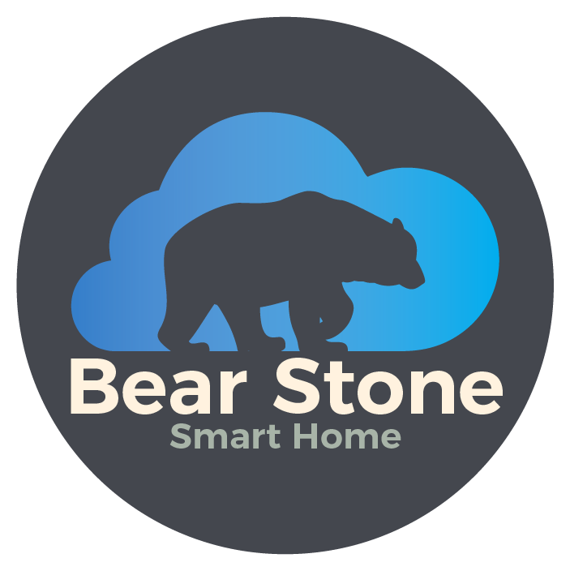

<h1 align="center">
  
   
  Bear Stone Smart Home Documentation
</h1>
<h4 align="center">Be sure to :star: my configuration repo so you can keep up to date on any daily progress!</h4>

  

Event-driven automations that sit outside the self-contained packages. These tie motion, presence, weather, and time-of-day signals together for real rooms and routines.

### Quick navigation
- You are here: `config/automation/` (standalone automations)
- [Repo overview](../../README.md) | [Config index](../README.md) | [Packages](../packages) | [Scripts](../script) | [Scenes](../scene)

### Featured files to browse

Camera-verified garbage and recycling reminders: [`garbage_day_garage.yaml`](Speech/garbage_day_garage.yaml)  

| File | Why it matters |
| --- | --- |
| [`garage_entry_light.yaml`](garage_entry_light.yaml) | Z-Wave door sensor + motion-controlled garage entry lighting from the garage automation walkthrough. [YouTube](https://youtu.be/wFO0H5zgnzk) |
| [`driveway_parked_car.yaml`](driveway_parked_car.yaml) | Frigate driveway-zone alert that notifies both parents with a camera preview, sends its household announcement through the LLM speech engine, and starts a full-screen Driveway takeover on both kiosks after the zone's 30-second loitering threshold. Guest mode snoozes all three actions without changing manual notification settings; after it ends, only a new occupancy detection alerts. The camera clears with occupancy or after ten minutes. [YouTube](https://youtu.be/X9qrywP3XS0) [Blog post](https://www.vcloudinfo.com/2026/09/home-assistant-frigate-driveway-car-alert.html) | Blue car sender icon: [Notification icon tip](https://youtu.be/TMfdxv-WprM) [Notification icon guide](https://www.vcloudinfo.com/2026/10/home-assistant-ios-notification-icons.html)
| [`zone_access_code_reminders.yaml`](zone_access_code_reminders.yaml) | Private per-person notifications for Adriano Gym and DeSantis Home, with stable tags that replace the previous push and codes loaded from `secrets.yaml`. |
| [`kitchen_sink_circadian.yaml`](kitchen_sink_circadian.yaml) | Sink light tunes its white temperature while on and starts automatically only for a 07:00-20:00 morning, confirmed bed-exit, or low-light event. Timer, sun, restart, and bed-entry updates respect an off light; TV, office work, guest mode, and bedtime gates remain. Kitchen Show illuminance avoids starts in an already-bright room. |
| [`dark_rainy_day.yaml`](dark_rainy_day.yaml) | Weather-aware lighting with an occupied/dim first-floor check and on-demand exterior camera corroboration before rain-driven lights or speech. Dry, uncertain, stale, watering, or failed checks skip the rain action; lightning lighting and safety alerts remain independent. |
| [`good_night.yaml`](good_night.yaml) | Whole-house shutdown and lock-up routine. |
| [`late_night_brightness_guard.yaml`](late_night_brightness_guard.yaml) | Scoped 20:00-06:00 brightness cap for direct user-activated living-room and outdoor front-light groups; nested scene and automation contexts are excluded. [Watch Night Brightness](https://youtu.be/XRciHrQhcxk) [Night Brightness blog](https://www.vcloudinfo.com/2026/10/home-assistant-nighttime-light-brightness-automation.html). The article also provides a portable whole-house alternative; it does not change this scoped rule. |
| [`late_night_helper.yaml`](late_night_helper.yaml) | Nighttime arrival path with the living-room M1 front-right light explicitly limited to 25% brightness. |

Bathroom night lighting requires an explicit in-bed to out-of-bed transition; recovery from an unavailable bed sensor does not switch on the accent outlet. Sunset and arrival behavior remain unchanged. The [Echo Glow automation](echo_glow_accents.yaml) follows the kitchen accents by default and the bathroom accents at bedtime, both at 50%. Living room accents take priority and use a 50% minimum. During Roku playback or pause, the Glow holds steady gold at 50% while the living room accents are on. An active entry alert overrides every mode with red.

Living room entry alerts require a garage door to remain open for five seconds, then restore each light's prior state after all entry points are secure.

TV Time ignores Raven playback and changes lighting only when both bed sensors explicitly report unoccupied. Missing Roku app IDs or unavailable bed sensors leave lighting unchanged.

### Tips
- Use these as patterns if you are migrating UI-created automations out of `automations.yaml`.
- Most automations expose helpers (input booleans, scenes) so you can extend them without editing IDs.

**All of my configuration files are tested against the most stable version of home-assistant.**

**Still have questions on my Config?**  
**Message me on X :** 

<a target="_blank" href="https://www.buymeacoffee.com/vCloudInfo">You can buy me a coffee</a>
 
 
<a href="https://www.vCloudInfo.com/p/affiliate-disclosure.html">
Affiliate Disclosure
</a>

