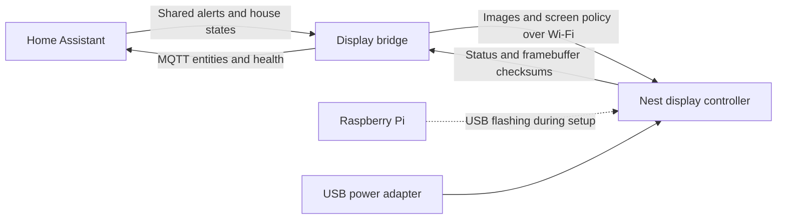

# An old Nest, a new living-room display

My retired second-generation Nest now sits under the TV, cycling through family photos and showing the same Home Assistant notifications as the other kiosks. Its original ring and center button advance the gallery.

## The hardware gets another job

Google ended app support and software/security updates for the first- and second-generation Nest Learning Thermostats on October 25, 2025. The [official support notice](https://support.google.com/googlehome/answer/16233096?hl=en) describes their continuing local thermostat operation. This project uses a spare Gen 2 as a display, separate from the home's HVAC controls.

A Raspberry Pi supplied the Linux USB flashing tools during setup. The original backplate, a charged thermostat and a USB data cable were part of that process. In the living room, the Nest uses a USB power adapter and Wi-Fi. The Pi's role was flashing and recovery.

## How the pieces fit

Home Assistant owns the shared notification feed and house states. A custom bridge prepares the images and messages, sends them to the Nest, and exposes display controls and telemetry through MQTT. The controller draws directly to the Nest's circular screen and reads the physical controls. The Home Assistant files below are the public examples in this repository; the bridge and controller are separate software.

## What it does in the house

| Feature | Behavior |
| --- | --- |
| Photo gallery | Up to 45 personal photos, with up to ten marked **Keep**. New photos replace the oldest unprotected photo when full. Joanna's current avatar stays outside the personal-photo limit. |
| Random rotation | Every picture appears once in a shuffled round before another round begins. Turning the ring or pressing the center advances the gallery. |
| Add a photo | I can send a picture from my phone to my agent, Joanna, and say "add this to the Nest." The bridge crops and delivers it to the display. |
| Ordinary notifications | Large icon, strong background color and short text take over the screen for two minutes, then photos resume. The other kiosks keep temporary notices in their rotation for five minutes. |
| Urgent conditions | The household alert feed takes priority until the condition clears. |
| Bedtime and away | Existing bed and family-presence states turn the screen off. Vacation Mode with a house-sitter visit keeps it available. A notice can wake it for its display window, then the current house state applies again. |
| Guest Mode | A pre-generated Wi-Fi QR image joins the gallery while Guest Mode is active. The private image and network credentials stay outside this repository. |
| Album controls | A kiosk submenu shows thumbnails, the photo count and Keep selections. **Refresh photo list** requests a snapshot when needed. |
| Dashboard preview | A round preview matches the device. Tapping refresh requests a screenshot; preview age is separate from device health. |
| Quiet recovery | Lightweight heartbeat and framebuffer checks watch the device and gallery. Bounded automatic recovery and dashboard status remain active; Nest health does not send phone alerts. |

The video shows the original 25-photo album and the ten entities available at recording time. The 45-photo limit, Keep selections and album submenu were added afterward and are covered in the companion article.

## Find the Home Assistant implementation

| Source | What to look for |
| --- | --- |
| [Kiosk package](../config/packages/kiosk_tablet.yaml) | Shared household alerts, retained temporary phone-notification feed, kiosk health and the Nest's advisory health handling. |
| [Kiosk health templates](../config/custom_templates/kiosk_health.jinja) | Shared health logic, with intentional Nest sleep and individual advisory health separated from household fault rollups. |
| [Kiosks dashboard](../config/dashboards/infrastructure/partials/kiosk_sections.yaml) | Round Nest preview, refresh action and health details alongside the other household displays. |
| [Nest Album submenu](../config/dashboards/infrastructure/views/05za_nest_album.yaml) | On-demand photo-list refresh, thumbnail buttons and the ten Keep slots. |
| [Infrastructure dashboard](../config/dashboards/infrastructure/dashboard.yaml) | Dashboard entry point and view includes. |

The screen policy reuses `group.bed`, `group.family`, Vacation Mode and house-sitter presence. The bridge follows those states, prepares the guest QR slide and handles photo delivery. The kiosk package supplies the common message feed. When adapting the pattern, connect your own house states and approved message sources rather than copying this home's entity names unchanged.

## Projects that made this possible

- [No Longer Evil - Cody Kociemba](https://github.com/codykociemba/NoLongerEvil-Thermostat): the starting point for giving supported early Nest hardware another use.
- [NestDFUAttack - exploiteers / GTVHacker](https://github.com/exploiteers/NestDFUAttack): the USB access work.
- [OMAP loader - grant-h / ajb142](https://github.com/ajb142/omap_loader): loader tooling used in the flashing path.
- [Home Assistant](https://www.home-assistant.io/): shared automations, MQTT entities and dashboards.

Use the upstream installation instructions for current model compatibility and flashing steps. The [project issue](https://github.com/CCOSTAN/Home-AssistantConfig/issues/1913) records this spare-device experiment. The [video](https://youtu.be/fuS1voqRznY) shows the physical display in the living room, and the [companion article](https://www.vcloudinfo.com/2026/10/repurpose-nest-thermostat-home-assistant-display.html) walks through how it fits into the house.
